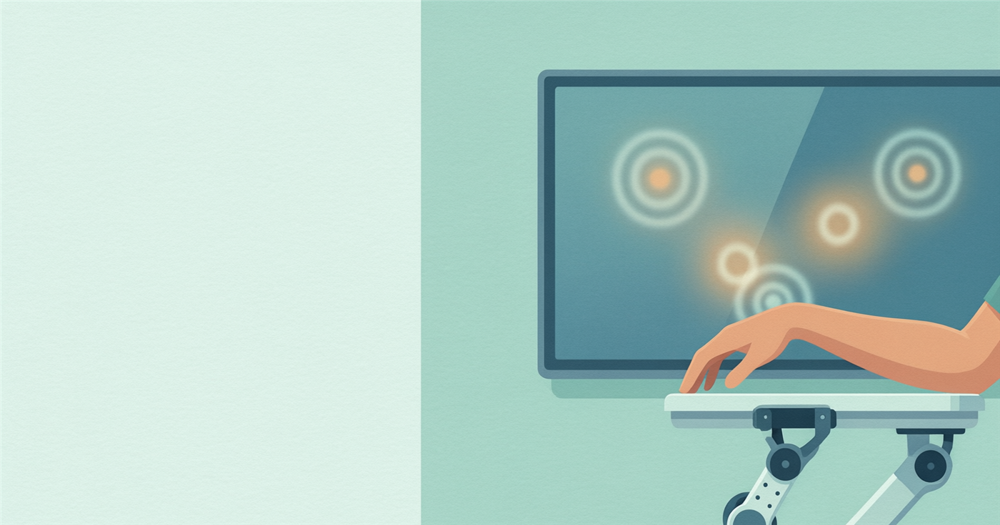
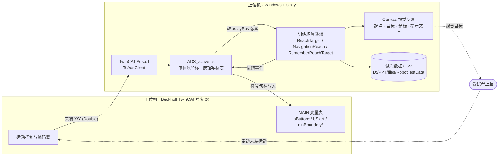
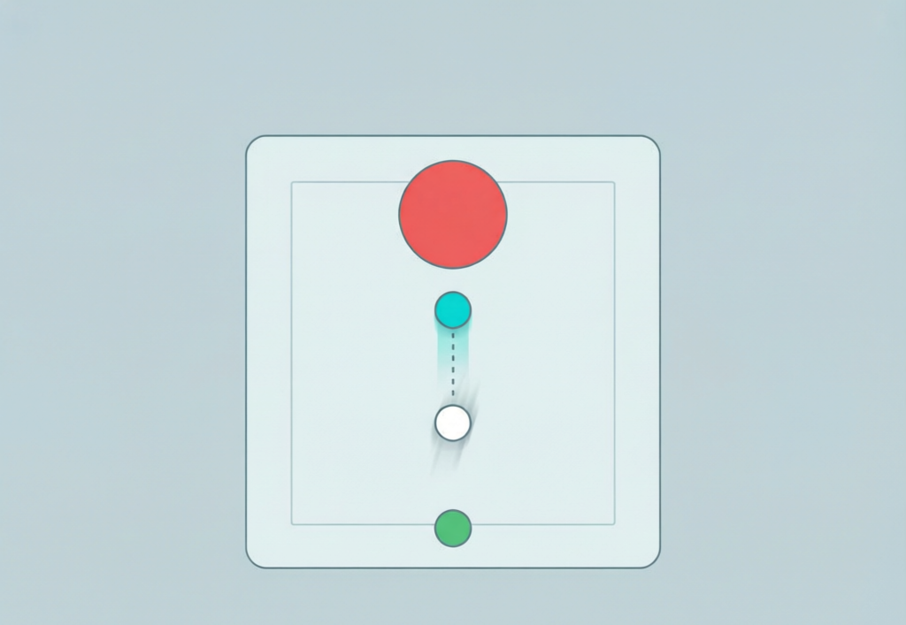
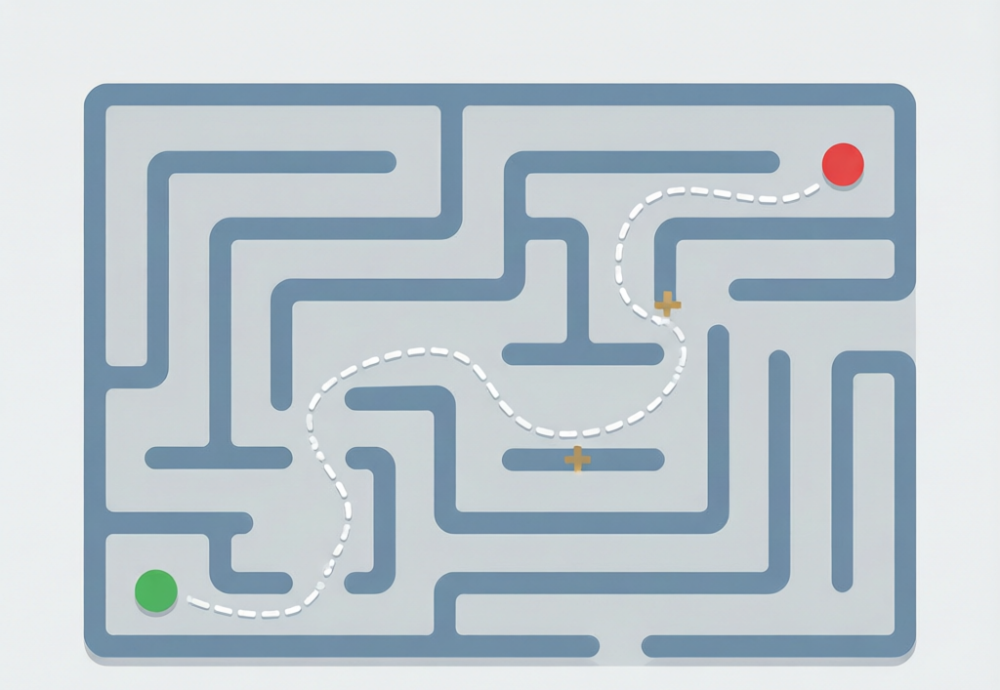
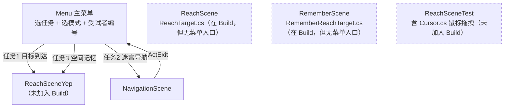
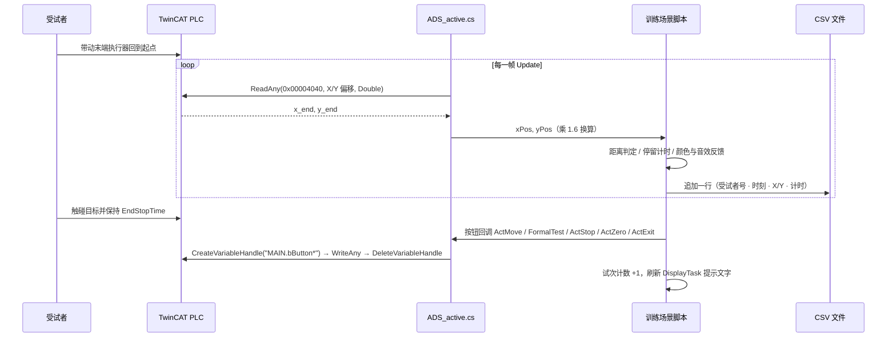

<div align="center">

# KinexTrain_robot

**机器人辅助手眼配合康复训练系统**
*Robot-Assisted Hand-Eye Coordination Rehabilitation Training System*

Unity 2020.3 · C# (.NET Framework 4.7.1) · Beckhoff TwinCAT ADS



</div>

---

本项目是一套**上肢康复训练上位机**：用 Unity 呈现视觉训练任务，通过 Beckhoff TwinCAT 的 ADS 协议与下位机 PLC 通信，
实时读取患者末端执行器（手部）的笛卡尔坐标并映射到屏幕，同时把训练状态、按钮指令和越界事件写回控制器。
Unity 侧是**监督层 / HMI**，运动控制与安全逻辑在 PLC 中实现。

> **用途声明**：仓库内的代码是科研与工程调试阶段的产物，未经医疗器械认证，不含安全回路实现，
> 不得直接用于临床。设备联调前必须先确认 PLC 侧的速度、力矩与急停限制。

## 目录

- [它做什么](#它做什么)
- [系统架构](#系统架构)
- [训练任务](#训练任务)
- [场景与导航流](#场景与导航流)
- [一次试次的时间线](#一次试次的时间线)
- [硬件链路：TwinCAT ADS](#硬件链路twincat-ads)
- [训练数据输出](#训练数据输出)
- [快速开始](#快速开始)
- [操作说明](#操作说明)
- [关键可调参数](#关键可调参数)
- [工程结构与约定](#工程结构与约定)
- [已知问题与技术债](#已知问题与技术债)
- [第三方资源](#第三方资源)

## 它做什么

| 能力 | 实现位置 |
| --- | --- |
| 主菜单任务/模式选择、受试者编号录入 | `Assets/Scenes/Menu.unity` + `Assets/Scripts/ADS_active.cs` |
| 目标到达训练（追随移动靶 + 起点/终点停留判定） | `Assets/Scripts/ReachTarget.cs` |
| 迷宫导航训练（碰撞计数、越界事件上报 PLC） | `Assets/Scripts/NavigationReach.cs` |
| 空间记忆训练（8 宫格记忆 3 个目标） | `Assets/Scripts/RememberReachTarget.cs` |
| 轻量随机靶试次（新输入系统版本） | `Assets/Scripts/Specific/ReachSceneYep.cs` |
| 与 PLC 的双向 ADS 通信 | `Assets/Scripts/ADS_active.cs` |
| 试次级 CSV 数据落盘 | `ReachTarget.cs:157`、`NavigationReach.cs:147`、`RememberReachTarget.cs:184` |
| 窗口透明/置顶叠加层（Win32） | `Assets/Scripts/HyalineBackground.cs` |

## 系统架构



坐标换算（设备毫米 → 屏幕像素）在 `ADS_active.cs:61-62`：

```csharp
xPos =  y_end * scaleTureMonitor;          // scaleTureMonitor = 1.6f，显示屏与真实距离的比例
yPos = (-x_end + 285) * scaleTureMonitor;  // 轴交换 + Y 反向 + 285 mm 中心偏移
```

## 训练任务

三个任务的共同范式是：**在起点停留设定时长触发 → 完成运动目标 → 在目标处停留确认 → 计入试次**，
并按条件轮换（隐藏光标、白底、青色显示等）做对照。

> 下文三张任务图是依据代码中的坐标、配色与判定逻辑生成的**示意图**，不是实机截图。
> 实机画面欢迎补到 `docs/images/screenshots/`（Play 模式下 `Win+Shift+S`，或调用 `ScreenCapture.CaptureScreenshot()`）。

### 1. 目标到达任务 `ReachScene`

追随一个自动向上移动的目标点，保持光标跟在其上，最终到达终点。



*示意图（非实机截图）：底部绿色为起点，青色为移动靶，白色为受试者光标，顶部红色为终点。*

- 起点停留 `LastTime = 3 s` → 变绿并置 `nStartMove = 1`
- 追随窗口：光标与目标距离 `RobotMoveDistance < 10`（画布单位），脱离则 `nDropTimes++`
- 到达终点后停留 `EndStopTime = 1 s`，完成标记闪黄 `TaskDoneMarkTime = 1 s`
- `TestNum = 18` 试次，覆盖 6 种条件轮换（含 `MovePointSpeed` 40 / 80 两档）

### 2. 迷宫导航任务 `NavigationScene`

在约 30 段墙体构成的迷宫中把光标从 `StartPoint` 移到 `EndPoint`，沿途记录碰墙次数。



*示意图（非实机截图）：绿色起点、红色终点、虚线为手部轨迹、琥珀色叉号标记碰墙点。*

- 起点停留 `LastTime = 1.5 s` 启动；`RobotEndDistance < 10` 判为到达
- 每次接触墙体 `nCollisionTimes++`，并把 `nInBoundaryX / nInBoundaryY` 以 Int16 写回 PLC
- `TestNum = 15` 试次，5 种条件轮换

### 3. 空间记忆任务 `RememberScene`

8 个色块随机点亮（或显示数字）5 秒后隐藏，受试者需按记忆依次触碰其中 3 个。


*示意图（非实机截图）：8 宫格中 3 个为目标块，机械臂末端为触碰光标。*

- `RectNum = 8`、`RemNum = 3`，展示时长 `LastTime = 5 s`
- 触碰判定：最近块距离 `< 10` 且停留 `EndStopTime = 1 s`；正确变绿 + 提示音，错误变红 + 错误音
- 集齐 3 个后起点闪黄并重置；`TestNum = 10` 试次，数字/颜色两种条件轮换

### 4. 轻量随机靶 `ReachSceneYep`（不在 Build 列表）

用新 Input System 重写的版本：键盘光标 + 机器人光标双实体，从 8 个候选位中随机取一为靶，
靠 `PhysicsCheckStart`（停留 3 s）与 `PhysicsCheckEnd`（停留 1 s）驱动试次，`recordingNum` 计数。
该场景**不写 CSV、没有试次上限**，目前作为迭代中的实验场景存在。

候选位是以 `(0, -240)` 为圆心、半径 240 的一段半环（`Specific/ReachSceneYep.cs:14-21`）：

| # | localPosition | # | localPosition |
| --- | --- | --- | --- |
| 1 | `(0, 0)` | 5 | `(0, -480)` |
| 2 | `(169.71, -70.29)` | 6 | `(-169.71, -409.71)` |
| 3 | `(240, -240)` | 7 | `(-240, -240)` |
| 4 | `(169.71, -409.71)` | 8 | `(-169.71, -70.29)` |

> `ReachSceneYep.cs:29` 写的是 `Random.Range(1, 8)`，而 Unity 的整数重载**不含上界**，
> 因此 8 号位实际永远不会被抽到。

## 场景与导航流

`ProjectSettings/EditorBuildSettings.asset` 中启用的构建顺序为 **0 Menu → 1 NavigationScene → 2 ReachScene → 3 RememberScene**。



> **注意路由现状**：`ADS_active.cs:244-267` 的 `ActStart()` 把任务 1 和任务 3 都指向 `ReachSceneYep`，
> 因此虚线框中的 `ReachScene` / `RememberScene`（以及其中完整的 18/10 试次协议与 CSV 记录）
> 在当前菜单流程下**进不去**。要在编辑器里体验它们，直接打开对应场景并把 Menu 之外的场景当作启动场景运行。

## 一次试次的时间线



## 硬件链路：TwinCAT ADS

**依赖**：`Assets/Plugins/TwinCAT.Ads.dll`（托管封装，代码用 `using TwinCAT.Ads;` + `TcAdsClient`）。
同目录的 `TcAdsDll.dll` 是旧的本地库，仓库内**没有任何 P/Invoke 引用它**，可忽略。
两个 dll 的 `PluginImporter` 设置为 `Any platform enabled / Editor disabled`。

**运行环境**：需要本机安装 TwinCAT（含 AMS Router），并配置一条到控制器 NetId 的 ADS 路由。
路由/`.amsconfig`/PLC 工程**不在本仓库内**，需随机台提供。

| 项 | 值 | 位置 |
| --- | --- | --- |
| 控制器 AMS NetId | 见常量 `AMSNETID`（换机需改） | `ADS_active.cs:29` |
| 端口 | `PORT = 501`（连接但未使用）、`PORTMAIN = 851`（实际读写） | `ADS_active.cs:30` |
| 连接时机 | `Awake()` 中同步 `Connect()`，无 try/catch、无超时、不重连 | `ADS_active.cs:43-44` |

**读取（每帧轮询，未使用 AddNotification 事件订阅）**

| 索引组 | 偏移 | 类型 | 含义 |
| --- | --- | --- | --- |
| `0x00004040` | `0x00064EA0` | Double | 末端 X（设备坐标） |
| `0x00004040` | `0x00064EA8` | Double | 末端 Y（设备坐标） |

**写入（按符号名，临时句柄：Create → Write → Delete）**

| 符号 | 触发点 |
| --- | --- |
| `MAIN.bButtonTask1/2/3` | 菜单选择任务 |
| `MAIN.bButtonActive` / `MAIN.bButtonPassive` | 菜单选择主动/被动模式 |
| `MAIN.bStart` | 菜单点击「开始」 |
| `MAIN.bButtonMove` / `Stop` / `Zero` / `Exit` | 训练场景内 运动/停止/回零/退出 按钮 |

**写入（按绝对地址）**

| 偏移 | 类型 | 含义 |
| --- | --- | --- |
| `0x00064F38` | — | 起点指示灯 |
| `0x00064F39` | — | 目标指示灯 |
| `0x00064F1A` / `0x00064F1C` | Int16 | `nInBoundaryX/Y` 越界/碰墙状态 |

**故障行为**：控制器不可达时 `Connect()` 抛出，`ADS_active` 组件初始化中断；此后每帧的读取异常被
`catch` 吞掉并 `Debug.LogWarning`，表现为 `xPos/yPos` 恒为 0（机器人光标贴在画布原点）+ 日志刷屏。
同步读取阻塞主线程，半死状态会掉帧。**代码里没有"无硬件模式"开关**，见[快速开始](#快速开始)的替代路径。

## 训练数据输出

三个主训练脚本在正式测试时按**每帧一行**写 CSV：

```
D:/PPT/files/RobotTestData/ReachTarget_<受试者编号>_<nWriteTimes>.csv
D:/PPT/files/RobotTestData/NavigationReach_<受试者编号>_<nWriteTimes>.csv
D:/PPT/files/RobotTestData/RememberReach_<受试者编号>_<nWriteTimes>.csv
```

列为：受试者编号、墙钟时间、末端 X/Y、试次内计时。

**数据与隐私注意**

- 路径写死在 `D:/PPT/files/RobotTestData/`，且**没有 `Directory.CreateDirectory`** —— 目录不存在时 `StreamWriter` 直接抛异常。
- `nWriteTimes` 未见递增逻辑，不同场次会**覆盖同名文件**。
- 受试者编号来自菜单 `SubjectNumber` 输入框（默认值 `"test"`，`ADS_active.cs:37`）；
  但编号到 CSV 的传递链路目前是断的，见[已知问题](#已知问题与技术债)。
  另注意 `PlayerPrefs` 在 Windows 上写入注册表，属于会残留在机器上的数据。
- 若采集真实受试者数据，该 CSV 目录属于个人健康信息，请纳入本机保密与去标识化管理，不要随仓库提交。

## 快速开始

### 环境要求

| 组件 | 版本 | 说明 |
| --- | --- | --- |
| Unity | **2020.3.48f1c1** | 中国版（团结）修订号；`ProjectSettings/ProjectVersion.txt` |
| API 兼容级别 | .NET Framework（`apiCompatibilityLevel: 6`） | `TwinCAT.Ads.dll` 要求 |
| 输入后端 | Active Input Handling = **Both**（`activeInputHandler: 2`） | 旧 `Input.GetKey` 与新 Input System 并存的原因 |
| 操作系统 | Windows | 依赖 TwinCAT 与 Win32 互操作 |
| TwinCAT | 3.x + AMS Router | 需配置到控制器的 ADS 路由 |
| 包 | Input System 1.5.1、ugui 1.0.0、TextMeshPro 3.0.6、Timeline 1.4.8 | 见 `Packages/manifest.json` |

### 跑起来

```bash
git clone https://github.com/ChaoJ-Robot/KinexTrain_robot.git
```

1. 用 Hub 的 **Open other** 选择仓库根目录（不是 `Assets/`），Unity 会依据已提交的 `.meta` 重建 `Library/`，
   guid 与场景引用不会丢失。
2. 首次导入后确认 `Player Settings → Scripting Define / API Compatibility Level = .NET Framework`，
   否则 `TwinCAT.Ads` 引用会报错。
3. **有设备**：按[硬件链路](#硬件链路twincat-ads)核对 `AMSNETID` 与路由，打开 `Assets/Scenes/Menu.unity` 运行。
4. **无设备**（只想看界面/调 UI）：直接打开 `ReachScene` 或 `ReachSceneTest` 运行。
   - `ReachScene` 保留了方向键分支（`ReachTarget.cs:119-134`，`MoveSpeed = 50`），可用键盘驱动光标；
   - `ReachSceneTest` 挂了 `Player/Cursor.cs`，鼠标拖拽 `Player` 标签对象即可，完全不依赖 ADS；
   - `NavigationScene` 与 `RememberScene` 强制走 ADS 分支（键盘分支被注释），无硬件时光标不动。

### 打包

`File → Build Settings` 中已启用 4 个场景（Menu / NavigationScene / ReachScene / RememberScene），
启动场景为 `Menu`。注意 `ReachSceneYep` 与 `ReachSceneTest` **未加入列表**，被 `ActStart()` 引用的
`ReachSceneYep` 在 Player 包里会加载失败 —— 打包前需手动勾选。

## 操作说明

**主菜单**（`Menu.unity`，标题「机器人辅助手眼配合康复训练系统」）

| 界面元素 | 绑定的方法 | 作用 |
| --- | --- | --- |
| 目标到达任务 | `ActTask1` | 置 `iTask = 1` |
| 迷宫导航任务 | `ActTask2` | 置 `iTask = 2` |
| 空间记忆任务 | `ActTask3` | 置 `iTask = 3` |
| 主动模式 / 被动模式 | `ActActive` / `ActPassive` | 写 `MAIN.bButtonActive` / `bButtonPassive` |
| 开始 | `ActStart` | 需任务与模式都已选择，否则不跳转 |
| 结束 | `ActFinish` | 释放 ADS 客户端 |
| `SubjectNumber` 输入框 | `set_FormalSubjectNumber` | 受试者编号，默认 `test` |

**训练场景内按钮**：运动 `ActMove` · 停止 `ActStop` · 回零 `ActZero` · 正式测试 `FormalTest` · 退出 `ActExit`（退出同时 `Dispose()` ADS 客户端）。

**输入映射**（`Assets/Setting/Input System/PlayerInputControl.inputactions`）

| Action Map | Action | 绑定 | 实际使用者 |
| --- | --- | --- | --- |
| Player | `Move` (Vector2) | 左摇杆 / WASD / 方向键 / XR 2D 轴 / 摇杆 | `MoveControl.cs:25`（仅 `ReachSceneYep`） |
| Player | `Look`、`Fire` | 右摇杆、指针、扳机等 | 未被脚本消费 |
| UI | Navigate/Submit/… | Unity 默认 | EventSystem |
| — | 方向键（旧 Input Manager） | `Input.GetKey` | `ReachTarget.cs:119-134` |

## 关键可调参数

| 脚本 | 字段 | 默认值 | 含义 |
| --- | --- | --- | --- |
| `ADS_active.cs:25` | `scaleTureMonitor` | `1.6f` | 屏幕像素 / 设备毫米 比例 |
| `ReachTarget.cs:24-25` | `MoveSpeed` / `MovePointSpeed` | `50f` / `40f` | 光标速度、目标移动速度（条件 2 为 80） |
| `ReachTarget.cs:41-43` | `LastTime` / `EndStopTime` / `TaskDoneMarkTime` | `3f` / `1f` / `1f` | 起点停留、终点停留、完成闪烁 |
| `ReachTarget.cs:51` | `TestNum` | `18` | 试次数 |
| `NavigationReach.cs:22-42` | `MoveSpeed` / `LastTime` / `TaskDoneMarkTime` / `TestNum` | `90f` / `1.5f` / `1f` / `15` | 同上语义 |
| `RememberReachTarget.cs:29-63` | `MoveSpeed` / `RemNum` / `RectNum` / `LastTime` / `EndStopTime` / `TestNum` | `90f` / `3` / `8` / `5f` / `1f` / `10` | 记忆任务参数 |
| 各训练脚本 | 命中阈值 | `10f`（画布单位） | 起点、追随、终点距离判定 |
| `PhysicsCheckStart.cs:7` | `waitTime` | `3f` | 起点停留触发时长 |
| `PhysicsCheckEnd.cs:7` | `waitTime` | `1f` | 终点停留触发时长 |
| `PhysicsCheck.cs:9-10` | `checkRadius` / `playerLayer` | `4` / 位 `2048`（Layer 11） | 触发半径与检测层 |
| `MoveControl.cs:33` | `Speed` | 场景中为 `200` | 键盘光标像素/秒 |
| `Show.cs:8-9` | `ShowMode` | 场景中为 `1` | 1 = 跟随，0 = 中心对称镜像 |

## 工程结构与约定

```
KinexTrain_robot/
├── Assets/
│   ├── Scenes/          6 个场景（4 个在 Build 列表）
│   ├── Scripts/         训练逻辑 + ADS 通信
│   │   ├── Player/      光标、移动、显示、试次计时
│   │   ├── PhysicsCheck/起点/终点停留触发器
│   │   ├── Specific/    ReachSceneYep（新输入系统版本）
│   │   └── Setting/     Input System 动作资源
│   ├── Profebs/         EndPoint.prefab（红色目标）、PosPoint.prefab（浅蓝候选位），仅 ReachSceneYep 使用
│   │                    目录名拼写如此（应为 Prefabs），改名会断引用，保持原样
│   ├── Plugins/         TwinCAT.Ads.dll（+ 未使用的 TcAdsDll.dll）
│   ├── Audio/           背景音乐
│   └── CasualGameSounds/ 第三方音效包
├── ProjectSettings/
├── Packages/
└── docs/images/         本文档配图
```

**四条必须知道的约定**

1. **UI 与代码靠绝对层级路径耦合**：脚本里共 27 条不同的 `GameObject.Find("/...")`（30 处调用），
   例如 `/ReachCanvas/RobotPoint`、`/RememberCanvas/EndPoint8`、`/GameObject`、`/Canvas/Image/point`。
   **改父级、加中间容器、重命名、把节点设为 inactive 都会静默破坏训练逻辑** —— 不报错，只是数据不再更新。
   调整 UI 布局前请先导出路径清单做基线比对。
2. **`.meta` 必须入库**：`.gitignore` 刻意排除了 `Library/`、`Temp/`、`obj/`、`.vs/` 与自动生成的
   `.csproj`/`.sln`，但保留全部 `.meta`。缺 `.meta` 会让 guid 重生成，场景与 prefab 引用当场断裂。
3. **脚本编码混杂**：`ADS.cs`、`DrawCircleCentre.cs`、`TransmitData.cs` 是 UTF-8，
   其余多数（含 `ADS_active.cs`、三个训练脚本、`Player/*`）是 GBK/GB2312。
   以 UTF-8 保存会乱码；改动前务必确认单文件编码。
4. **Unity 自动重生成工程文件**：`Rehabilitation.sln` 与 `*.csproj` 不入库，由 Unity 打开时生成，
   克隆后不要手工创建。

## 已知问题与技术债

按影响排序，均已在代码中定位：

- **菜单路由与 Build 列表不一致**：`ActStart()` 把任务 1/3 都指向未入包的 `ReachSceneYep`，
  导致 `ReachScene`、`RememberScene` 及其完整试次协议与数据记录无法从菜单进入（`ADS_active.cs:244-267`）。
- **`ReachSceneYep` 的「正式测试」按钮目标为空**：UnityEvent 指向 `ReachTarget`，但该场景没有此组件（`ReachSceneYep.unity:639-641`）。
- **受试者编号链路未接通**：`SubjectNumberKey` 只声明、从未赋值，写入端 `ADS_active.cs:58` 与读取端
  `NavigationReach.cs:100` / `ReachTarget.cs:109` / `RememberReachTarget.cs:136` 都用 `null` 当 key，
  菜单输入的编号并没有真正传到 CSV 的编号列（实际取到空串或默认值）。另外该 `SetString` 位于读取坐标的
  `try` 块内且在其之前，若运行时对 null key 抛异常，会连带跳过本帧的坐标读取 —— 上机前建议实测确认。
- **`nWriteTimes` 不递增**：多场次数据互相覆盖同名 CSV。
- **无重连与超时**：`Connect()` 在 `Awake` 一次性完成，异常仅 `LogWarning`，控制器掉线后光标冻结在 (0,0)。
- **端口 501 客户端连接后从未使用**（`ADS_active.cs:43`）。
- **死代码**：`ADS.cs`、`TransmitData.cs`、`DrawCircleCentre.cs`、`HyalineBackground.cs` 未挂载到任何场景；
  `ADS.cs` 里含一套基于 `l1 = 292`、`l2 = 210` 连杆长度的正运动学（单位推断为 mm，工作空间半径 130），可作为机械结构参考。
- **PLC 符号与绝对地址混用**：读取用裸偏移（`0x00064EA0` 等），写入用符号名，PLC 变量表变更后极易失配，
  且仓库内没有 PLC 工程可供比对。

## 第三方资源

- **Beckhoff TwinCAT / TwinCAT.Ads.dll** — ADS 通信，版权归 Beckhoff Automation GmbH & Co. KG。
- **Casual Game Sounds (DMCGS)** — `Assets/CasualGameSounds/`，许可见该目录内 `license.pdf`。
- **Unity 2020.3.48f1c1** 及内置模块（Input System、uGUI、TextMeshPro、Timeline）。

## 许可

仓库暂未声明许可证。如需在本项目之外复用代码，请先联系维护者确认授权范围
（注意其中包含第三方 dll 与音效包的独立许可条款）。
